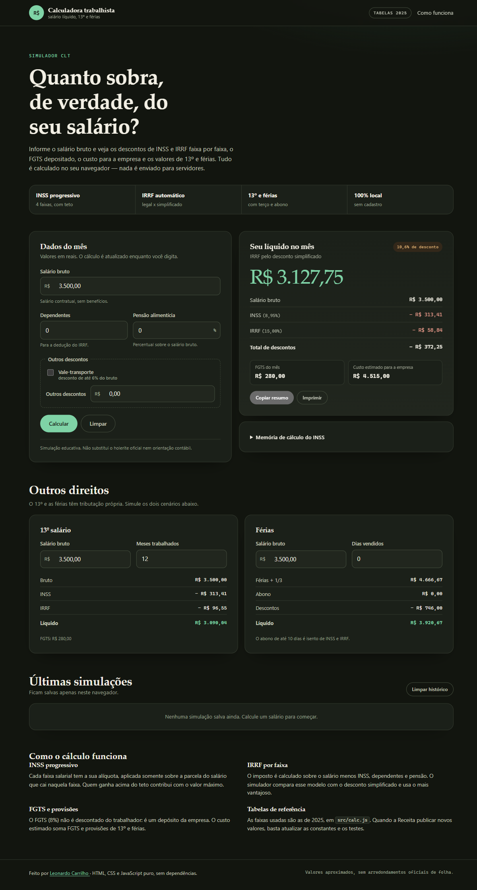

# Calculadora trabalhista

[](https://github.com/LeonardoCarrilho/calculadora-trabalhista/actions/workflows/ci.yml)
[](LICENSE)

Simulador de salário líquido CLT feito com **HTML, CSS e JavaScript puro** — sem
framework, sem build e sem back-end. Informe o salário bruto e veja INSS, IRRF,
FGTS, custo do empregador, 13º salário e férias, com memória de cálculo.

**Demo:** https://leonardocarrilho.github.io/calculadora-trabalhista/



## Por que este projeto existe

Trabalho com departamento pessoal e folha de pagamento. Na prática, quase toda
dúvida de um colaborador começa com a mesma pergunta: *"por que o meu líquido
veio diferente do que eu esperava?"*. Este projeto transforma essa experiência
em uma ferramenta de cálculo aberta, testada e explicável.

## Funcionalidades

- **INSS progressivo** por faixa, com teto de contribuição e alíquota efetiva.
- **IRRF** comparando automaticamente deduções legais e desconto simplificado.
- **Dependentes e pensão alimentícia** aplicados na base do imposto.
- **Vale-transporte** (6%) e outros descontos livres.
- **FGTS** do mês e **custo estimado do empregador** com provisões de 13º e férias.
- **13º salário** proporcional, com INSS e IRRF exclusivos.
- **Férias** com terço constitucional e abono pecuniário isento.
- **Histórico local** das últimas cinco simulações (localStorage).
- **Copiar resumo** e **imprimir** somente o resultado.
- Tema claro/escuro automático, layout responsivo e navegação por teclado.

## Rodar localmente

Não há dependências de produção.

```bash
git clone https://github.com/LeonardoCarrilho/calculadora-trabalhista.git
cd calculadora-trabalhista
npm start
# http://localhost:4173
```

Também é possível abrir o `index.html` diretamente — os módulos ES funcionam
melhor com um servidor local, e o `scripts/serve.js` já cumpre esse papel.

## Testes

O motor de cálculo fica isolado em `src/calc.js`, sem acesso ao DOM, e é coberto
por testes nativos do Node (`node:test`):

```bash
npm test
```

Os testes cobrem as quatro faixas do INSS, o teto, cada faixa do IRRF, a escolha
entre dedução legal e simplificada, dependentes, pensão, vale-transporte, 13º
proporcional, férias com e sem abono e arredondamentos.

## Estrutura

```
.
├── index.html            # interface semântica e acessível
├── styles.css            # tema claro/escuro, responsivo e estilos de impressão
├── src/
│   ├── calc.js           # regras de cálculo puras (centavos, sem DOM)
│   └── app.js            # formulário, máscara de moeda, resultados e histórico
├── test/calc.test.js     # testes com node:test
├── scripts/serve.js      # servidor estático de desenvolvimento, sem dependências
├── assets/favicon.svg
└── .github/workflows/ci.yml
```

## Regras e premissas

As tabelas ficam em `src/calc.js` (`INSS_FAIXAS`, `IRRF_FAIXAS`,
`DEDUCAO_DEPENDENTE`, `DESCONTO_SIMPLIFICADO`) e usam a **referência de 2025**:

| INSS (salário de contribuição) | Alíquota |
| --- | --- |
| até R$ 1.518,00 | 7,5% |
| R$ 1.518,01 a R$ 2.793,88 | 9% |
| R$ 2.793,89 a R$ 4.190,83 | 12% |
| R$ 4.190,84 a R$ 8.157,41 | 14% |

O IRRF usa a tabela mensal com dedução de R$ 189,59 por dependente e desconto
simplificado de R$ 564,80. Para atualizar, basta alterar as constantes e rodar os
testes — os valores esperados estão documentados caso a caso.

Premissas da simulação:

- O vale-transporte é estimado como 6% do bruto.
- A pensão é um percentual do bruto e reduz a base do IRRF.
- O custo do empregador soma salário, FGTS, 1/12 de 13º, 1/12 de férias + 1/3 e
  o FGTS sobre essas provisões.
- O abono de férias é tratado como indenizatório (isento de INSS e IRRF).
- Não são considerados horas extras, adicionais noturnos, faltas, afastamentos,
  plano de saúde, empréstimos consignados ou arredondamentos oficiais de folha.

**Aviso:** é uma ferramenta educativa e não substitui o holerite oficial, a
convenção coletiva ou orientação contábil.

## Stack

HTML5 semântico · CSS moderno (variáveis, grid, `prefers-color-scheme`,
`prefers-reduced-motion`) · JavaScript ES Modules · `node:test`.

## Licença

[MIT](LICENSE) © Leonardo Fernandes Carrilho
